# Architecture

How cmdEssentials is built and how its code fits together. For the rules every change has to
follow, see [AGENTS.md](../AGENTS.md); this page explains the design behind them. The diagrams
are [Mermaid](https://mermaid.js.org/) and render on GitHub.

## 1. Two axes: loaders and Minecraft versions

The same source tree produces 8 jars: 4 Minecraft versions × 2 loaders.

- **Loaders are Gradle modules.** `common` holds all logic and only sees vanilla Minecraft
  (Mojang mappings) and Brigadier. `fabric` and `forge` are thin adapters that bundle `common`
  into their jar.
- **Minecraft versions are Stonecutter nodes.** Each module is compiled once per version from
  the same files. API differences are written as `//? if >=1.20.5 {` comments, which Stonecutter
  turns into active or commented-out code for each version. These comments live only in
  `compat/` adapters and in the loader modules.

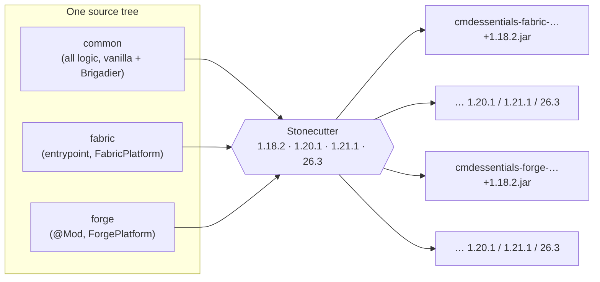

| Build piece | Role |
|---|---|
| `settings.gradle.kts` | Declares the Stonecutter tree (versions × `common`/`fabric`/`forge`); 26.x nodes use `build.unobf.gradle.kts` (no remapping) |
| `stonecutter.gradle.kts` | Active version, class-name replacements (`ResourceLocation` → `Identifier`), `buildAndCollect`, `runActiveServer*` |
| `versions/<mc>/gradle.properties` | Java version, Minecraft ranges, Fabric API, Forge version, pack format |
| `buildSrc/` | `versionProp(...)` and other helpers shared by the module scripts |

## 2. Layers at runtime

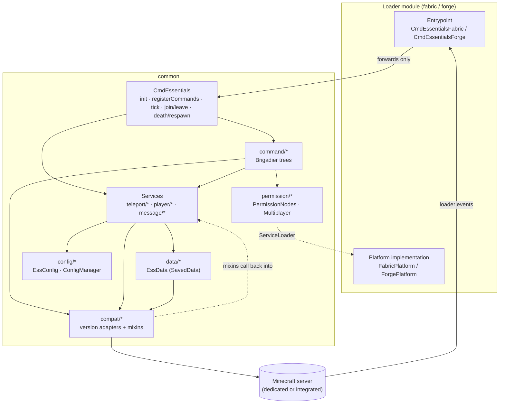

Rules that keep this shape:

- The loader modules contain no logic: they subscribe to their events and call the matching
  `CmdEssentials` hook. Loader-specific needs (permission checks, config directory, version)
  go through the `Platform` interface, which `common` finds with `java.util.ServiceLoader`.
- Commands call services and adapters; they never contain `//?` blocks.
- Only `compat/` touches APIs that differ between Minecraft versions.

## 3. Modules (packages in `common`)

| Package | What it contains |
|---|---|
| `CmdEssentials` | The hooks the loaders call. Wires every command class and every service tick; clears in-memory state on server stop |
| `platform` | `Platform` interface: loader name, mod version, config dir, `hasPermission`, `getInt` |
| `permission` | `PermissionNode` (name, OP fallback, multiplayer-only flag), `IntOption` (numeric options such as the home limit), `PermissionNodes` (the single list both loaders register), `Multiplayer` (is anyone else able to be here?) |
| `config` | `EssConfig` (Gson-mapped `config.json`, options named after EssentialsX `config.yml`), `ConfigManager` (blocking first load, async reload, async save) |
| `message` | `Messages` (per-player language lookup, `{0}` templates, colours), `TextFiles`/`TextDocument` (motd, rules, info), `Broadcast`, `MessagingService` (`/r` history), `Nicknames` |
| `data` | `EssData` (the one `SavedData`: warps, kits, spawn, jails, per-player records), `PlayerRecord`, `StoredLocation`, `Kit`, `MailMessage` |
| `teleport` | `TeleportService` (delay, cancel on move, cooldown, `/back`), `TpaRequests`, `SafeSpots`, `RandomTeleport` |
| `player` | Per-player features: `AbilityService` (fly/god), `AfkService`, `Sessions`, `Mutes`, `JailService`, `VanishService`, `PlayerView` (ptime/pweather), `ItemPowers` (power tools, unlimited) |
| `menu` | `PortableMenus` (workbench, anvil, … with a real `ContainerLevelAccess`), `InvseeMenu`/`InvseeContainer` |
| `command` | One class per command or family; each has `static register(dispatcher)` |
| `compat` | Version adapters (`Texts`, `Players`, `ItemData`, `Books`, `Fireworks`, `Potions`, `Tags`, `Worlds`, `VersionedSavedData`, …) and `compat/mixin` |
| `util` | Pure Java, unit-tested: `DateDiff`, `Pager`, `TimeOfDay` |

### Command classes

| Class | Commands |
|---|---|
| `EssentialsCommand` | `/cmdessentials` (`/ess`): version, `reload` |
| `HomeCommands`, `SpawnCommands`, `WarpCommands`, `BackCommand` | homes, spawn, warps, `/back` |
| `TpaCommands`, `TeleportExtraCommands` | `/tpa` family; `/tphere`, `/tppos`, `/top`, `/tpr`, `/world`, … |
| `SpeedCommand`, `PlayerStateCommands`, `AfkCommand` | `/speed`; `/fly`, `/god`, `/heal`, `/feed`, `/rest`, `/ext`, `/suicide`; `/afk` |
| `LocationInfoCommands`, `PlayerInfoCommands`, `TextCommands` | `/getpos`, `/near`, …; `/seen`, `/whois`, `/playtime`, `/ping`; `/motd`, `/rules`, `/info` |
| `MessagingCommands`, `MailCommands`, `BroadcastCommands`, `NickCommands` | `/msg`, `/r`, toggles, `/ignore`, `/socialspy`, `/helpop`; `/mail`; `/broadcast*`; `/nick`, `/realname` |
| `InventoryCommands`, `KitCommands` | `/invsee`, `/enderchest`, `/hat`, `/repair`, portable blocks, …; kits |
| `ModerationCommands`, `JailCommands` | `/mute`, `/tempban`, `/kickall`, `/sudo`, `/gc`; jails |
| `ViewCommands`, `WorldCommands` | `/ptime`, `/pweather`, `/vanish`; `/thunder`, `/lightning`, `/tree`, `/spawnmob`, … |
| `ItemCommands`, `ItemMetaCommands` | `/item`, `/itemname`, `/skull`, `/powertool`, …; `/book`, `/firework`, `/potion` |
| `VanillaAliases` | `/gm*` shortcuts and the `e`-prefixed vanilla redirects |

## 4. Static structure

### Platform and permissions

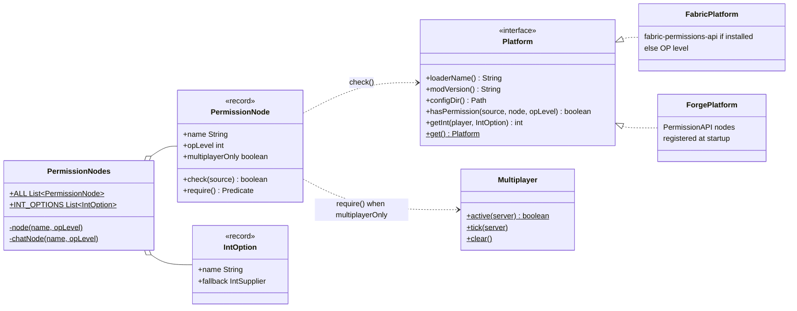

`require()` is what commands pass to Brigadier's `.requires(...)`. For a chat node it is false
while `Multiplayer.active` is false, so the command is neither suggested nor runnable.

### Persistent data

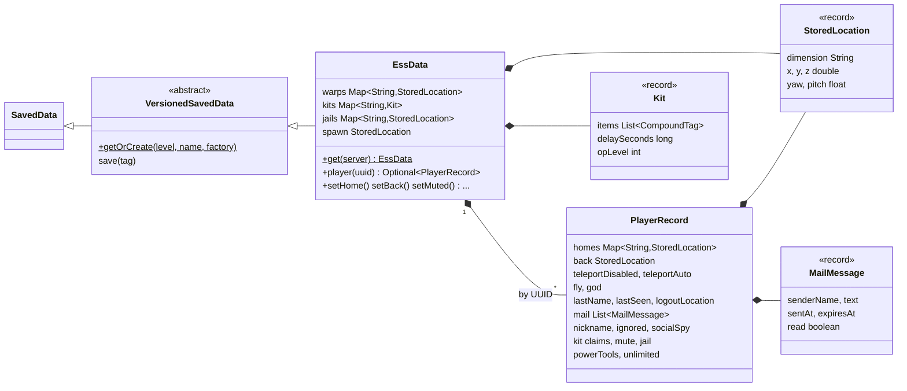

- One `EssData` lives on the overworld: `<world>/data/cmdessentials.dat`, or from 26.1
  `<world>/dimensions/minecraft/overworld/data/minecraft/cmdessentials.dat`.
  `VersionedSavedData` hides the save API changes and reads the old file once on 26.1+.
- All mutation goes through `EssData` methods so the data is marked dirty and saved with the world.
- Kept in memory only (cleared in `onServerStopping`): pending teleports and cooldowns, `/tpa`
  requests, AFK state, sessions, `/r` targets, vanish, ptime/pweather.

### Item meta adapters (`/book`, `/firework`, `/potion`)

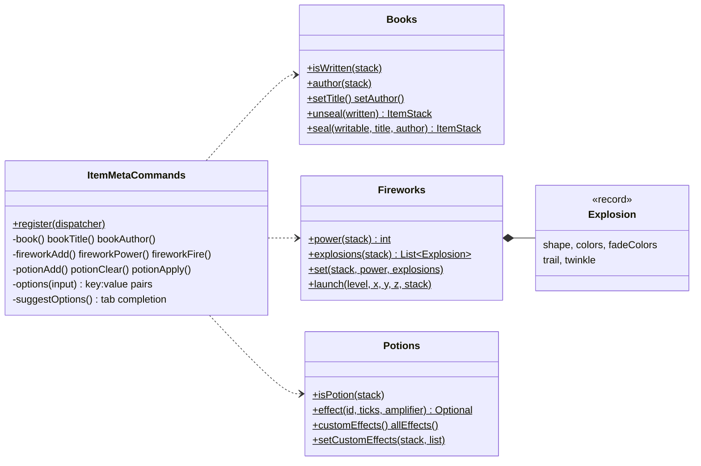

| Adapter | Before 1.20.5 | 1.20.5 and later |
|---|---|---|
| `Books` | NBT `title`, `author`, `pages` (JSON text on written books) | `written_book_content` / `writable_book_content` components |
| `Fireworks` | NBT `Fireworks` {`Flight`, `Explosions`} | `fireworks` component |
| `Potions` | NBT `CustomPotionEffects`, `PotionUtils` | `potion_contents` component (4 fields on 26.1+) |

The command code only sees plain Java values (`String`, `List<Integer>`, `MobEffectInstance`);
each adapter method has one branch for NBT and one for data components.

## 5. Behaviour

### Startup and command registration

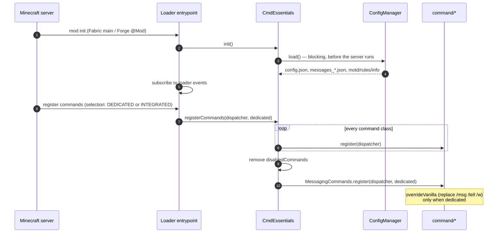

### A player's own teleport (`/home`, `/spawn`, `/warp`, accepted `/tpa`)

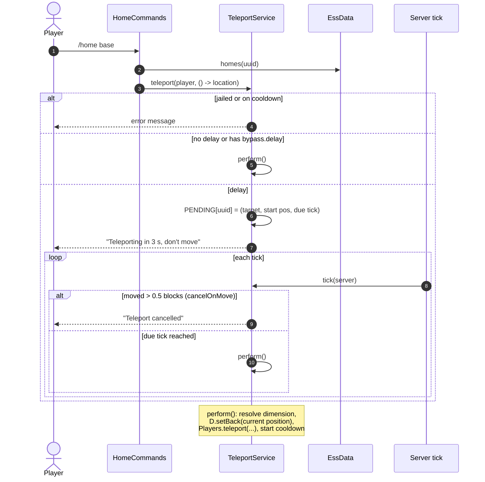

The target is a `Supplier`, evaluated when the teleport happens. For `/tpa` that means the
traveller goes to wherever the other player is at that moment.

### `/tpa` → `/tpaccept`

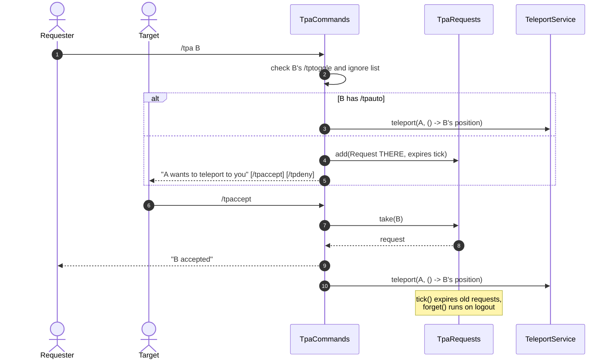

### Private messages and chat hooks

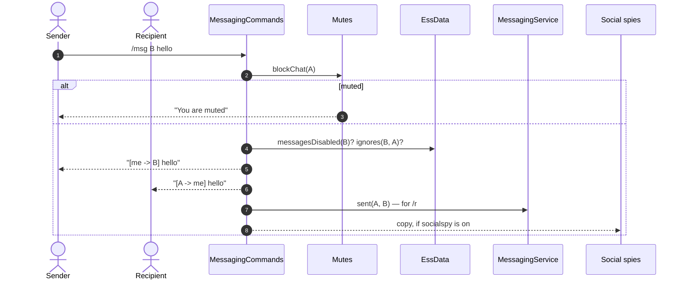

Public chat is not a command, so it is seen by `ServerGamePacketListenerImplMixin`:

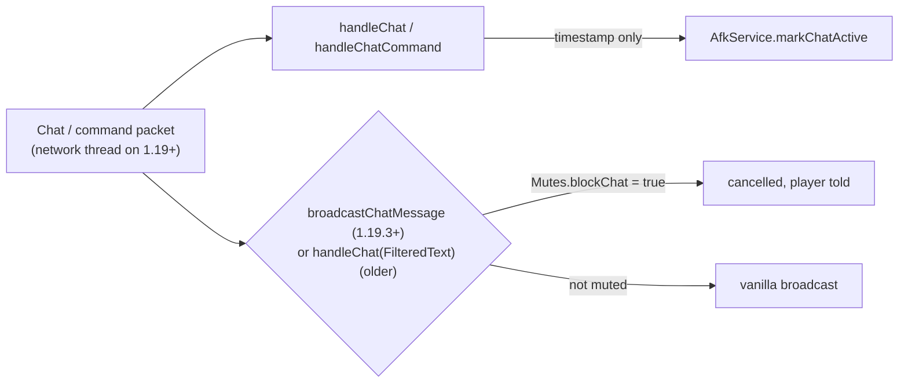

Mutes cancel at the broadcast, never when the packet arrives: dropping a signed chat packet
breaks last-seen tracking and gets the player kicked.

### Config reload

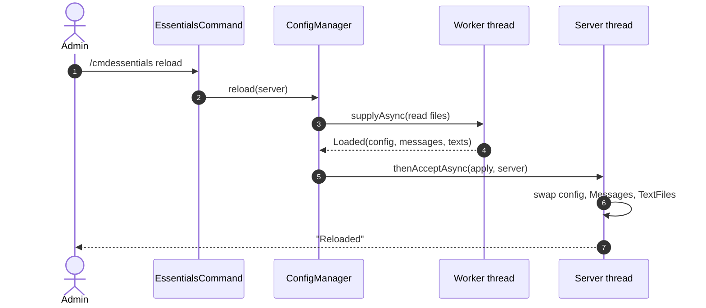

The server thread never waits on file I/O while the server runs.

### Singleplayer, LAN and the chat commands

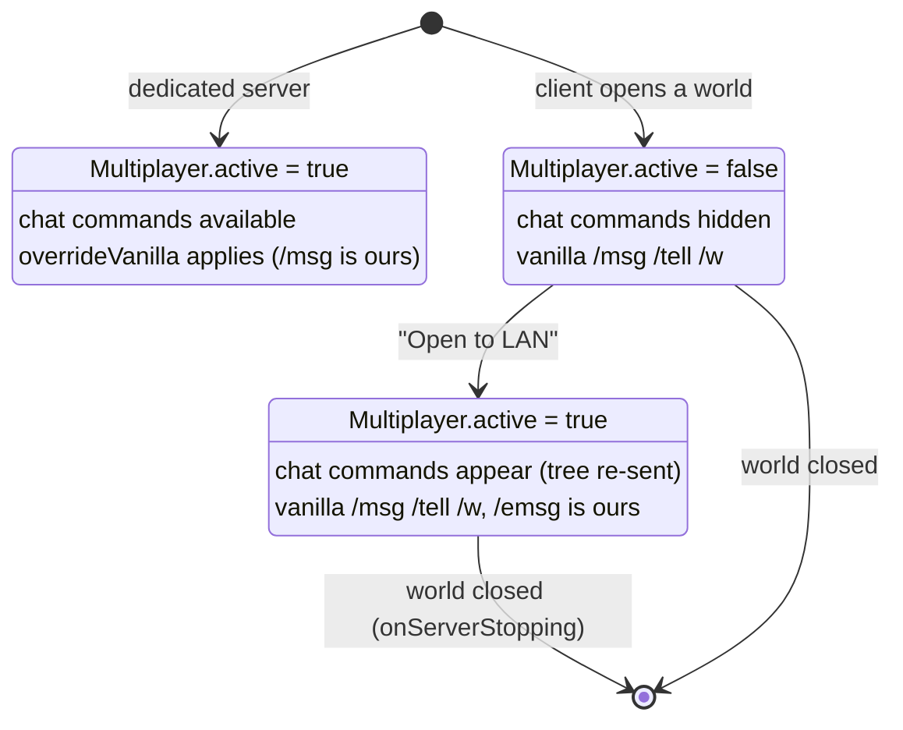

`Multiplayer.tick` compares `active()` with the last value every tick and, when it changes,
calls `Commands.sendCommands` for each player so clients see the new command list at once.

### Item meta: `/potion effect:speed power:2 duration:30`

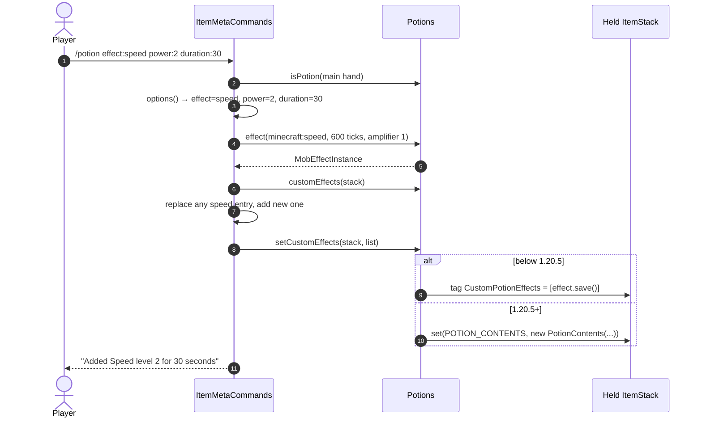

The held stack is changed in place; the menu's change detection sends it to the client.
`/book` instead replaces the stack (`setItemInHand`), because a written book and a book and
quill are different items.

## 6. Implementation notes

**Threads.** Everything runs on the server thread except file reads/writes in `ConfigManager`
and offline `/playtime`. The chat mixin runs on the network thread on 1.19+, so it only records
a timestamp; `AfkService.tick` does the state change.

**Ticks.** `CmdEssentials.onServerTick` drives every time-based service: pending teleports,
`/tpa` expiry, fly/god re-apply (once a second), AFK, jail release, per-player time/weather,
power tools and `Multiplayer`.

**Integrated servers.** A client starts a new server for each world it opens, but static
fields live as long as the game. Every service with static state has a `clear()` called from
`onServerStopping`.

**Permissions.** With a permission provider (LuckPerms on Fabric through
fabric-permissions-api; Forge's `PermissionAPI`) nodes are checked there; without one, the
node's OP level applies. Forge needs every node registered at startup, which is why
`PermissionNodes.ALL` is the single list, and why kits use an OP level plus an optional
`cmdessentials.kits.<name>` node instead of new nodes.

**Messages.** No user-facing string is hard-coded. `CommandUtil.ok/fail/tell` render a key from
`messages_<lang>.json` in the recipient's language. Vanilla translation keys (effect names,
item names) may be passed as arguments; our own translation keys may not, because vanilla
clients have no lang file for them.

**Mixins.** `cmdessentials.common.mixins.json` lists them; Architectury Loom remaps their
targets per loader, so the jars carry no refmap.

| Mixin | Target | Used by |
|---|---|---|
| `ServerPlayerMixin` | `ServerPlayer.updateOptions` | client language before 1.20.2 |
| `ServerGamePacketListenerImplMixin` | chat/command handlers, chat broadcast | AFK, `/mute` |
| `TrackedEntityMixin`, `ChunkMapAccessor` | `ChunkMap$TrackedEntity.updatePlayer` | `/vanish` |
| `ServerPlayerGameModeMixin` | `useItem`, `useItemOn` | `/powertool` |
| `PlayerMixin`, `ServerPlayerListNameMixin` | display name, tab-list name | `/nick`, AFK tag |

**Adding a command**

1. Add its nodes to `PermissionNodes` (and to `ALL`). Use `chatNode` if it only makes sense
   with other players online; add an `.others` node if it can target someone else.
2. Write `command/<Name>Commands.register(dispatcher)`; guard nodes with `.requires(NODE.require())`,
   register aliases as redirects (copy `executes` for aliases without arguments).
3. Put any version-specific API in a `compat/` adapter, not in the command.
4. Add the message keys to `en_us.json` and `zh_cn.json`.
5. Call `register` from `CmdEssentials.registerCommands`.
6. Add test steps to `docs/testing/`, then run `./gradlew buildAndCollect`.
